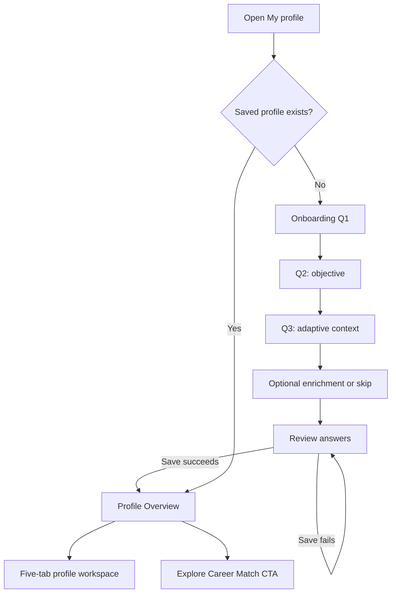

# Minder — User Profile Frontend Design & Engineering Context

**Artifact version:** 2.0 · **Date:** 24 October 2026 (Malaysia)  
**Module:** User Profile · **Design status:** Visual direction approved through reference mockups; implementation is an interactive local HTML proof, not production React/FastAPI integration.  
**Primary preview:** `minder-user-profile-prototype-v2.html`

> Give this file **and the HTML prototype** to the implementing Codex agent. The HTML is the executable reference for layout and front-end behavior; this document is the specification for components, states, data boundaries, and acceptance tests. Do not silently replace it with the previous blue-accented prototype.

## 1. Product definition and non-negotiable decisions

Minder User Profile is a living account/profile workspace, **not a dashboard**. It supports a short setup, a reliable source of user-confirmed context, focused edits, evidence/records, and a deliberate link to Explore Career Match.

The product owner approved:

1. A **different interface before and after first-time setup**. Do not show the completed-profile five-tab navigation during onboarding.
2. Three **core adaptive onboarding questions**: current situation; immediate objective; context relevant to that branch. Optional enrichment can be skipped. Review is confirmation, not a fourth mandatory question.
3. Detailed constraints (study time, budget, commute, etc.) **later, at the point of use**.
4. Successful save → **Profile Overview** → prominent **Explore Career Match** button; never auto-run matching.
5. Completed profile: **text-based circular initials avatar**, name, then a short current-status subtitle; this entire identity block is **optically centered over the horizontal five-tab pill**. The axis is the *main content area excluding the left sidebar*.
6. Five and only five top-level profile sections: **Overview | Background | Goals & Preferences | Skills | My Record**. Rounded outlined pill, centered, in one horizontal row on desktop, with icon+label per tab and quiet sage active state.
7. Exactly **one focused section panel visible at a time**. The avatar/name/tabs persist unchanged when switching sections. Do not move or duplicate user identity inside the Overview card.
8. **Inline field editing with Save and Cancel**. One field/group at a time, dirty-edit navigation guard, no long edit-all page or modal form.
9. The right-side explanatory card may appear during early onboarding; no permanent right analytics/help rail after profile creation. Secondary help is an opt-in drawer.
10. Layout, components, icons, typography and palette must follow the supplied sage/neutral Minder screenshots; **no blue/purple theme, vivid gradient cards, statistics-wall, or floating dashboard grids**.

## 2. Visual source of truth and reference screen inventory

The two original provided screenshots define the overall Minder design system: brand/sidebar/topbar, black typographic hierarchy, white and pale-green surfaces, minimal borders, subtle radii and restrained muted sage selection.

The subsequently approved **completed-profile identity layout** appears in these design reference PNGs (source preview assets, not browser captures):

| Section | Approved source mockup filename |
|---|---|
| Overview | `exec-fa20d6f8-80bc-4d6e-b754-a3f7f2f5d2ea.png` |
| Background | `exec-b5470494-0d20-4984-95b9-d3d46d0107b0.png` |
| Goals & Preferences | `exec-14dc05ee-f360-4eea-8fb9-e4cd6a35be2a.png` |
| Skills | `exec-14490b7a-2f62-4f57-806d-a0538088e0a8.png` |
| My Record | `exec-022507da-9262-4a54-878b-1f3a0347045f.png` |

The onboarding concept images: situation `exec-89a65ca9-c1cc-4524-a667-60a51be62851.png`; student objective `exec-c338e451-8bea-4cd4-966b-81a2c90ec05f.png`; student study context `exec-335809e1-020c-42b7-8d8d-6ce8b540abde.png`; review `exec-c2232b44-f6b9-426f-828c-96e1713083aa.png`.

**Interpretation:** The image previews determine visual hierarchy and composition; they do **not** grant permission to invent missing backend data or claim exact numeric fit scores. The HTML prototype is the deterministic implementation of those visual rules. Genuine browser screenshots of the HTML must be used for pixel QA.

## 3. Concrete design system implemented by the HTML

The values below are actual CSS values in the companion v2 HTML, selected to reproduce the approved visual references. They are **implementation tokens**, not extracted Figma variables. If the main Minder app already has canonical tokens, map semantics to the verified tokens while retaining perceived design consistency.

| Token | v2 CSS value | Purpose |
|---|---|---|
| `--background`, `--surface` | `#ffffff` | Dominantly white canvas and panels |
| `--ink` | `#101514` | Primary black heading and body text |
| `--secondary` | `#667184` | Muted helper text |
| `--line` | `#e3e8e5` | Thin subtle dividers/outline |
| `--line-strong` | `#d3dbd6` | Inputs/secondary button borders |
| `--sage` | `#eaf1eb` | Avatar, selected tab, calm icon disks |
| `--sage-light` | `#f5f8f5` | Low emphasis hover/surfaces |
| `--forest` | `#345c46` | Primary actions and deep sage accent |
| `--forest-dark` | `#254834` | Primary hover |
| `--radius` | `11px` | Most cards/controls |
| `--sidebar-width` | `276px` | Desktop fixed/persistent sidebar |
| `--font` | `Inter, ui-sans-serif, -apple-system, BlinkMacSystemFont, "Segoe UI", Helvetica, Arial, sans-serif` | Modern neutral UI stack, no remote font fetch |

### Desktop layout rules

- Straight-on 16:9 app screenshot reference, approximately 1672 × 940. Fit actual content naturally; allow vertical page scrolling if needed.
- Persistent white sidebar, ~276px wide, faint right border. Top `minder.` brand, one `+ New conversation` button, `YOUR SPACE` links, `KEEP MOVING` links, pale sage encouragement block, bottom account row.
- Main topbar ~80px high: breadcrumb left; search visual, pale Ask Minder action, current initials avatar right.
- Main content starts below topbar with airy horizontal padding (`54px` on wide desktop).
- Onboarding: left main question card with small green step/progress indicator; optional slim “Why we ask this” help card to right only on Q1/Q2. Q3 uses sparse form; review is a clean row list.
- Completed profile: global page title **Your profile** remains aligned left at top; **avatar, name, descriptor** form a vertically stacked centered hero beneath/adjacent to it. Avatar ~116px circular, initials black, bold name ~34px; paragraph beneath 16px muted.
- Under identity: **centered pill** max-width ~1050px, height ~68px, white surface and thin border, five tabs with icons and pale sage selected item. Tab panel underneath is a *single* thin-bordered white region, not five cards.
- Within panels use rows, subtle dividers, compact right pencil actions, pale sage CTA/info band, ample but controlled whitespace. Avoid duplicating the global user-name card in Overview.
- Typography: bold black ~50px page titles, ~24px section titles, ~14–16px content, ~12–13px secondary notes. Restrained spacing and consistent optical alignment matter more than decorative effects.

### Responsive behavior

- Desktop: full sidebar + five-tab pill in a single row.
- Tablet: sidebar can collapse to icon rail, preserving main content priority.
- Mobile: compact top brand, no desktop sidebar rail; **five tabs must remain horizontally scrollable**, never shrink text to microscopic sizes. Main panels stack facts and editable rows, identity stays centered relative to content.
- Keyboard: visible focus, semantic native buttons/fields, accessible tab names, clear labels, Escape close on help and modal, reduced-motion respect.

## 4. Frontend sitemap and navigation

The self-contained HTML uses URL hashes for interactive preview only. Production must map these concepts to the existing router, without creating a competing routing scheme.



| User-visible screen | Prototype hash | Production semantic route (illustrative) |
|---|---|---|
| Q1 situation | `#/profile/setup/situation` | `/profile/setup?step=situation` |
| Q2 objective | `#/profile/setup/objective` | `/profile/setup?step=objective` |
| Q3 context | `#/profile/setup/context` | `/profile/setup?step=context` |
| Optional enrichment | `#/profile/setup/optional` | `/profile/setup?step=optional` |
| Review/create | `#/profile/setup/review` | `/profile/setup?step=review` |
| Overview | `#/profile/overview` | `/profile?section=overview` |
| Background | `#/profile/background` | `/profile?section=background` |
| Goals & Preferences | `#/profile/goals` | `/profile?section=goals` |
| Skills | `#/profile/skills` | `/profile?section=skills` |
| My Record | `#/profile/record` | `/profile?section=record` |
| Career Match destination | `#/explore/career-match` | Existing Explore Career Match route; verify |
| Explore Skills destination | `#/explore/skills` | Existing Explore Skills route; verify |

On a real navigation event, only the central tab content replaces; global/sidebar/topbar/identity/tab rail persist. Implement browser Back/Forward and deep links. If there are dirty edits, show Stay/Discard before changing location. When an external module links directly to Profile Skills, return to origin where known.

## 5. Onboarding UX contract and adaptive questions

### Q1 — Situation

Question: **Where are you in your journey?**

Six selections: **I'm studying; I'm entering the workforce; I'm working; I'm changing careers; I'm between roles; Something else.** One active choice at a time. Continue requires a choice. The currently approved demonstration takes the **I'm studying** branch; the production implementation must still support the others. Do not preselect a student's status for a real new account.

### Q2 — Objective

Question: **What would you like help with?**

For students show:

1. Discover careers that fit me.
2. Prepare for internships or my first job.
3. Build a path toward a career.
4. Explore future opportunities.
5. I'm not sure yet.

For non-students adjust the language for the current career stage, retaining the same broad goal intents. Continue requires a choice, and changing Q2 updates the next Q3 prompt.

### Q3 — Conditional context (one main question)

| Situation / goal | Prompt | Input behavior |
|---|---|---|
| Student + discover fit | **What are you studying?** | Field of study. Educational level and institution optional supporting inputs, matching approved visual |
| Student + internship | **What are you studying?** | Field of study; study year only when an internship flow needs it |
| Student + career path | **Which career are you interested in?** | Role or broad career name |
| Student + future | **Which fields or technologies interest you?** | Optional free-text interest areas |
| Student + unsure | **Which subjects or activities do you enjoy?** | Optional low-pressure response |
| Career changer + specific path | **Which career would you like to move toward?** | Optional role |
| Career changer + exploration | **What kind of work do you do now?** | Optional current background |
| Entering workforce | **What did you study or learn most recently?** | Optional study/learning context |
| Other paths | Most relevant single question | Do not add mandatory constraints |

In the reference student/fits branch, **Field of study** is the main answer; the Education level and Institution fields shown in the screenshot are optional. An “I haven't decided yet” answer is valid. Editing earlier responses should not silently wipe input without making consequences clear.

### Optional enrichment, then review

After Q3, offer one skippable screen **“Anything else you'd like Minder to know?”** with a short self-reported text field. The user may choose **Skip for now**. It is **not a fourth mandatory question**. The Review screen shows three core answers and any optional context that exists, each with a clear change action. **Create my profile** persists confirmed answers, reports actual success/failure, and opens Overview. **Explore Career Match** is then the primary next action—not automatic.

### Profile name dependency

Do not introduce another mandatory name question into this three-question flow. In production, obtain `displayName` from the authenticated user's account identity (or an existing approved identity field), then let the user correct it via focused inline edit. The standalone HTML lacks authentication, so it uses **Avery Lim** as a clearly synthetic account placeholder. It is **not** an inferred name from educational answers.

## 6. After-onboarding screen contents

| Tab | Focused content | Primary interaction and boundaries |
|---|---|---|
| **Overview** | Profile summary: current stage, focus, education and institution, with one pale-sage callout | **Explore Career Match →**; secondary **Edit profile details**. Never show AI performance numbers or ranking in this tab |
| **Background** | Current stage, context/study field, education level, institution | Edit exactly one row at a time; Save/Cancel; missing values say **Not added yet** |
| **Goals & Preferences** | Current focus, career interests, preferred work areas | Inline editing; link to Career Match; contextual “Why this matters” opens optional drawer. Constraints are not required up front |
| **Skills** | Self-reported list and confidence levels; empty state when none | Add, edit confidence, remove skill; prevent duplicate names; distinguish user report from evaluated mastery. **Explore Skills** handles role gap analysis |
| **My Record** | Three accordion rows: **Projects & experience**, **Achievements & certificates**, **Supporting files** | At most one group expanded; useful empty states. Demo can add user-entered project/achievement; file upload unavailable unless storage is integrated |

Future verified evidence/strengths, documents and profile timeline can live *within My Record*. Do not fabricate entries simply to populate the preview. Avoid implementing a second unrelated analytics page under My Record.

## 7. User-name-to-initials specification

The initials avatar must not be a static `AL` image. It is a **derived view** of the current saved `displayName`.

Algorithm:

1. Trim leading/trailing whitespace, split into non-empty words.
2. If 2+ words, use first grapheme of the first and last words; for one word, use first two graphemes.
3. Apply locale-aware uppercase. If empty, show `?` instead of inventing a name.
4. Keep circular avatar centered in the content area and keep all dependent account avatar placements in sync.

Examples: `Avery Lim` → **AL**, `Junhong` → **JU**, `Nur Aina Rahman` → **NR**. Avoid deriving from email when verified name is available. Support non-Latin Unicode grapheme clusters.

Name change flow: click accessible edit action next to name → focused text field → Cancel (restore) or Save (validate, persist, update displayed full name and initials). Identity component is shared by every post-onboarding tab.

## 8. State, domain model and ownership

The HTML stores only demonstration data in browser `localStorage` under separate versioned keys for saved profile and onboarding draft. This is **not a backend API or production persistence contract**. Do not copy the localStorage mechanism to the real authenticated product without a deliberate privacy/reliability decision.

Illustrative TypeScript UI view model (adapt to the real approved User Profile Schema V1; names below are NOT guaranteed backend names):

```ts
type Stage = 'studying'|'entering'|'working'|'changing'|'between'|'other';
type Goal = 'fit'|'internship'|'path'|'future'|'unsure';
type SkillConfidence = 'Learning'|'Practicing'|'Confident';

type ProfileView = {
  version: 2;
  displayName: string;            // source: authenticated account identity
  stage: Stage;                   // user-confirmed
  goal: Goal;                     // user-confirmed
  context: string;                // branch-relevant Q3 answer
  educationLevel?: string;
  institution?: string;
  enrichment?: string;
  interests: string[];
  preferredWorkAreas?: string;
  skills: Array<{
    id: string;
    name: string;
    level: SkillConfidence;
    source: 'self-reported';      // assessment/evidence require separate verification
  }>;
  records: {
    projects: Array<{id:string; title:string; description?:string}>;
    achievements: Array<{id:string; title:string; description?:string}>;
    files: Array<{id:string; name:string; storageRef:string}>;
  };
  createdAt: string;
  updatedAt: string;
};
```

### Production integration boundaries

- FastAPI/backend owns schema validation, persistence, authorization and user ownership. Frontend owns interaction state, dirty edits, focus, error/empty/loading/success UI and navigation.
- Reuse existing TS types and route/API conventions. **Do not invent specific REST paths, request fields, auth headers or fake responses** as if verified. Resolve actual monorepo files before writing adapters.
- Frontend adapter semantics need operations equivalent to `load profile`, `create profile`, `update permitted field/group`, `list/add/remove self-reported skill`, `list/create record`, plus supporting file APIs only if real.
- Do not announce success until the backend confirms. Keep unsaved input on validation/network failure.
- Matcher receives saved profile through validated boundary. It owns Career Match results; the User Profile module never computes AI fit scores or pretends a role probability from three questions.
- Editing profile facts may invalidate downstream recommendations. Signal a need to refresh matches; **do not silently overwrite** a saved roadmap or user-chosen career.
- Inferred AI/agent suggestions require review and confirmation before becoming user-owned profile facts.

## 9. Components and recommended React + TypeScript decomposition

The self-contained HTML intentionally has CSS/JS inline for easy review. It is **not** a recommendation to copy one 75KB HTML file into production React. A reasonable implementation decomposition, subject to existing project conventions:

```text
frontend/src/features/profile/                # illustrative path; verify repo
  ProfilePage.tsx                           # load/route/empty/error shell
  ProfileIdentity.tsx                       # centered initials/name/description
  ProfileSectionTabs.tsx                    # shared rounded five-tab pill
  onboarding/
    ProfileOnboarding.tsx                   # 3-question controller + optional/review
    SituationStep.tsx
    ObjectiveStep.tsx
    AdaptiveContextStep.tsx
    OptionalEnrichmentStep.tsx
    ReviewStep.tsx
  sections/
    ProfileOverview.tsx
    ProfileBackground.tsx
    ProfileGoals.tsx
    ProfileSkills.tsx
    ProfileRecord.tsx
  components/
    InlineFieldEditor.tsx
    ProfileFactRow.tsx
    RecordDisclosure.tsx
    ProfileContextDrawer.tsx
    UnsavedChangesGuard.tsx
    StatusMessage.tsx
  profile.types.ts                          # mirror verified backend contracts
  profile.api.ts                            # real API adapter; no invented URLs
  profile.validation.ts
  profile.test.tsx
```

Extract page shell/sidebar/topbar to existing global design components where available. Centralize visual tokens once. Use consistent outline icons; do not ship image-generated icon bitmaps. Choose accessible semantic buttons, `<nav>`, real forms, and keyboard behavior.

## 10. Interaction state contract

| Event | UI/state expectation | Failure/edge case |
|---|---|---|
| Open profile, no saved profile | First setup step | Show loading/error correctly before assuming absent on API failure |
| Open profile, saved profile | Centered avatar/name/tabs and Overview | Deep link selects a specific section without re-onboarding |
| Change Q1 or Q2 | Update dependent options/context prompt | Preserve valid answers; prompt if incompatible already-entered data would be lost |
| Back during onboarding | Return to previous step with response intact | No hidden data deletion |
| Skip enrichment | Go to Review without requiring another answer | Three mandatory core questions retained |
| Create profile | Save → confirmed Overview | Disabled duplicate submit and explicit retry; never lose draft on failure |
| Edit a field | One row becomes inline editor | Keyboard focus enters field; Cancel restores saved value |
| Save inline field | Validate → persist → show confirmed value | On failure keep edit open and show accessible error |
| Navigate while edit is dirty | Confirm Stay or Discard | No silent discard, including browser Back/Forward |
| Switch tabs | Shared avatar/name/navigation stay put; only section panel changes | Active tab reflected in route and ARIA |
| Add/edit/remove skill | Update self-reported inventory | Reject duplicates, support transparent removal behavior |
| Expand My Record | Exactly one open group at a time | Honest empty state when zero items |
| Open contextual explanation | Right drawer only on demand | Escape/close, return focus, appropriate dialog semantics |
| Explore Career Match | Navigate to existing Explore module | If minimum evidence missing, ask just-in-time question or honestly limited exploration |

## 11. Browser screenshot and QA handoff

Use Playwright/Cypress against actual rendered HTML/React views, not image-generation output. Capture at desktop reference viewport **1672×940** and test a narrow viewport ~390×844. In production compare spacing, alignment, selected-tab state, readable copy, zero clipping/overflow and avatar center with approved mockups.

Required screenshot states:

1. Onboarding situation selected = studying.
2. Student objective selected = discover careers that fit me.
3. Student field-of-study step populated.
4. Optional enrichment (if implemented) and Review.
5. Saved Overview with **centered identity above five-tab pill** and Career Match CTA.
6. Background focused inline editing Save/Cancel.
7. Goals & Preferences selected; drawer opened as secondary state.
8. Skills populated and empty/add state.
9. My Record expanded and another disclosure collapsed.
10. Dirty-edit Stay/Discard, save failure, browser Back, keyboard, mobile horizontal tabs.

### Acceptance gates

**Visual** — Same sage/white Minder shell, no extra dashboard cards, correct optical centering in main content, five tabs centered and identical for every post-profile section, avatar/name absent from onboarding and not repeated inside Overview, responsive labels stay usable.

**Functional** — Three-question branching, optional skip and review, save to Overview, initial-profile vs returning-profile distinction, name-edit updates initials, Save/Cancel, dirty guard, URL history, no fabricated module data.

**Integration** — Real authenticated profile create/load/update, verified types, error/loading/success states, no fake backend endpoints, no unverified AI claims, existing monorepo conventions respected, automated tests pass.

## 12. Codex implementation brief (copy into a task)

> Implement the Minder User Profile frontend in the existing repository using the approved `MINDER_USER_PROFILE_DESIGN_CONTEXT.md`, `minder-user-profile-prototype-v2.html`, and five approved post-onboarding visual mockups. First inspect `AGENTS.md`, existing global shell, router, design tokens/components and the actual backend User Profile Schema V1. Reuse the production React/TypeScript structure and verified FastAPI contracts. Preserve the three-question adaptive onboarding, optional enrichment, review/save transition, and five centered post-setup tabs. Build one shared `ProfileIdentity` using the authenticated display name and derived initials, optically aligned above the pill and persistent across sections. Implement focused inline Save/Cancel edits, dirty-navigation guard, realistic empty/error/loading states, separate Profile Skills vs Explore Skills responsibilities, and honest Career Match navigation. Do not introduce another blue/colored dashboard design; do not copy this standalone HTML wholesale into the React app; do not invent AI scores or unimplemented endpoints. Add responsive and keyboard coverage, screenshot regression review at desktop/mobile, and tests for all acceptance gates. Report actual integration blockers rather than silently stubbing them.

## 13. Demo semantics and limitations

- Default: no saved browser profile → first-time setup. The demo persists a draft and completed profile using versioned browser storage; refresh works in the same browser origin.
- An isolated, explicitly synthetic populated state can be invoked once with `?demo=profile`, then hash-based tabs. This creates sample **Avery Lim**, Python and Problem solving entries strictly for UI review.
- Small user-account menu in the sidebar allows **Reset demo** after confirmation to reproduce first-time onboarding.
- Avatar initials derive from current name; editing and saving the display name updates the central and small account avatars. Demo account name is not tied to a real identity provider.
- Explore Career Match, Explore Skills, Chat, Mindbot, roadmap and tasks are transparent **out-of-scope destination placeholders** in this isolated HTML; they do not claim working AI, agents or backend integrations.
- Project/achievement entries in this local demo are user-entered only; file uploading is intentionally not simulated as durable functionality.
- The HTML preview tests interaction/visual decisions only. A production signoff requires actual backend integration, auth, a11y and screenshot/browser QA.

**Change-control:** The v2 HTML and this design-context file are the handoff pair. New decisions should change the context contract and corresponding shared component(s) together. Do not maintain independent drifting copies of Minder's design rules in scattered prompt files.

### Verification status at handoff

- `node minder-user-profile-v2-structural-test.mjs`: **passed** for syntax, state transitions, adaptive Q3, saved-profile routing, dynamic avatar initials, Save/Cancel, interests/skills/record editing, duplicate prevention, dirty-change guard and reset.
- `node minder-user-profile-v2-test.mjs`: **prepared but not executed successfully** in this environment because no Chromium binary is installed. Browser download did not provide a valid archive, and using a remote browser on this local project was not authorized. This file is for local execution after installing Playwright Chromium, and is not a claimed passing end-to-end test.
- The approved PNGs shipped in the handoff are **design-reference images**, not screenshots captured from this HTML. Production screenshot/visual review remains a required gate.
